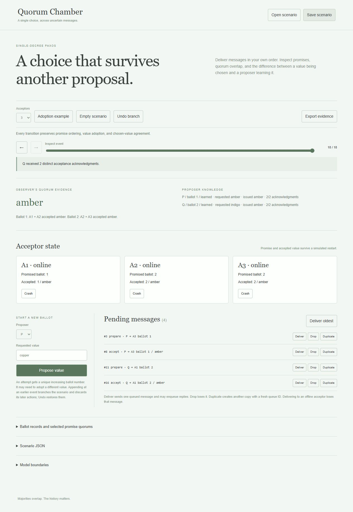

# Quorum Chamber

A single-decree Paxos simulator with explicit message delivery, loss, duplication, acceptor crashes/restarts, branching replay, and quorum evidence. It distinguishes a value being chosen from a proposer learning that fact.



## Run

```sh
python run.py --port 8000
```

Open http://127.0.0.1:8000. Python 3.10+ serves static assets; replay runs locally in a browser module worker. Node 22+ runs the dependency-free tests. There is no actual network, database, or external service.

## Follow the example

The 18-action example starts P's ballot 1 requesting `amber`. A1 and A2 promise, then accept it. At event seven, a majority has accepted: the value is chosen, although P has received **zero** acceptance acknowledgments. Two later messages let P learn the outcome.

Q then opens ballot 2 requesting `indigo`. Its promise quorum includes A2, which reports previously accepting ballot 1's `amber`. Q must adopt that reported value. A2 and A3 accept `amber` in ballot 2, and Q eventually learns it. The two quorum witnesses overlap at A2.

Inspect event seven to see chosen-versus-learned, or the final state to compare Q's requested and issued values. Deliver the remaining stale messages to see rejection by higher promises. Crash and restart an acceptor: its promise and accepted record remain intact within the simulated state.

## Controls

- Start attempts from P or Q, with 1–40 printable ASCII characters as the requested value.
- Deliver any pending message, drop it, or duplicate it. Each duplicate has a fresh queue ID but preserves protocol content. **Deliver oldest** is a convenience, not an automatic network scheduler.
- Crash/restart any acceptor. Messages delivered while it is offline are lost; pending messages not delivered remain queued.
- Scrub snapshots, then append from an earlier point to create a new branch. Undo restores up to 30 prior branches and their inspection positions.
- Choose three or five acceptors, which starts an empty scenario; the adoption example uses three.
- Save/open scenario JSON or export all snapshots and quorum evidence. Scenario editing is explicit; Save exports the applied action history.

The bounded model permits 160 actions and 60 pending messages. Invalid actions and queue-limit failures reject the whole transition without partial effects. Files/editor input are capped at 100 KB. [Example scenario](docs/example.json).

## Protocol rules

The simulator assigns unique increasing integer ballots. A proposer sends prepares to every acceptor. An online acceptor promises a ballot at least as high as its current promise, returning its highest accepted ballot/value; lower ballots receive a rejection. Equal-ballot prepare retries are idempotent responses.

After receiving promises from a distinct majority, the proposer freezes that promise quorum. It adopts the highest-numbered accepted value reported there, or uses its own requested value when none was reported. It sends phase-two accept requests to all acceptors. An acceptor accepts only a ballot at least as high as its promise, persists the new promise/accepted pair in the model, and replies with an acknowledgment.

Duplicate responses are counted by acceptor identity. Late promises after entering phase two do not change the issued value. Starting another attempt supersedes that proposer's current response handler; stale responses are ignored. Rejections are recorded but do not cause automatic retry. A proposer reaches `learned` after distinct-majority acknowledgments.

The observer separately derives chosen values from the complete historical acceptance-vote set. A chosen value remains chosen after crashes or later acceptance records overwrite earlier ones. Quorum witnesses record the first observed majority for each ballot; they are not necessarily every acceptor that eventually votes for it. This observer has global simulation knowledge that individual proposers do not.

Every transition checks accepted-ballot ≤ promised-ballot, majority promises before phase two, adoption of the highest accepted value in that quorum, one value per ballot, and agreement among all historically chosen ballots.

## Scope

This is a single-decree educational state machine, not Multi-Paxos, Raft, leader election, or a production consensus service. Simulated durable fields survive **simulated** crashes only; save the scenario to retain it across browser sessions. There is no disk durability, proposer crash recovery, automatic timeout/retransmission, Byzantine behavior, authenticated transport, membership change, or replicated command log.

Real proposers need a distributed scheme for unique ballot numbers; the central simulation allocator is explicitly a modeling convenience. The model assumes non-forged messages created by its own state transitions. Safety checks and randomized tests are not a formal proof. Progress can stop under loss, unavailable majorities, or competing attempts, even while chosen-value agreement holds.

## Verification

```sh
npm test
npm run check
python -m unittest discover -s tests -v
```

Six JavaScript tests cover value adoption, choice before learning, duplicate quorum suppression, restart persistence, stale acceptance rejection, offline delivery loss, atomic invalid transitions, and 500 adversarial schedules of up to 100 actions across three/five acceptors. Historical vote sets independently check chosen-value agreement; promise values must never decrease. A Python HTTP test checks asset restrictions, Host validation, and HEAD responses. CI runs Node 22/24 on Linux and Node 24 on Windows.

Browser checks exercised crashes/restarts, duplicate delivery, stale-ballot rejection, earlier-event branching/undo, and the event-seven knowledge distinction. Independent Python verification reconstructed acceptance quorums from delivered messages across all 19 exported snapshots and checked monotone promises, adoption choices, acknowledgments, and the saved scenario.

Protocol background: Leslie Lamport's [Paxos Made Simple](https://lamport.org/pubs/paxos-simple.pdf). The simulator's scheduling and persistence boundaries are documented above.
